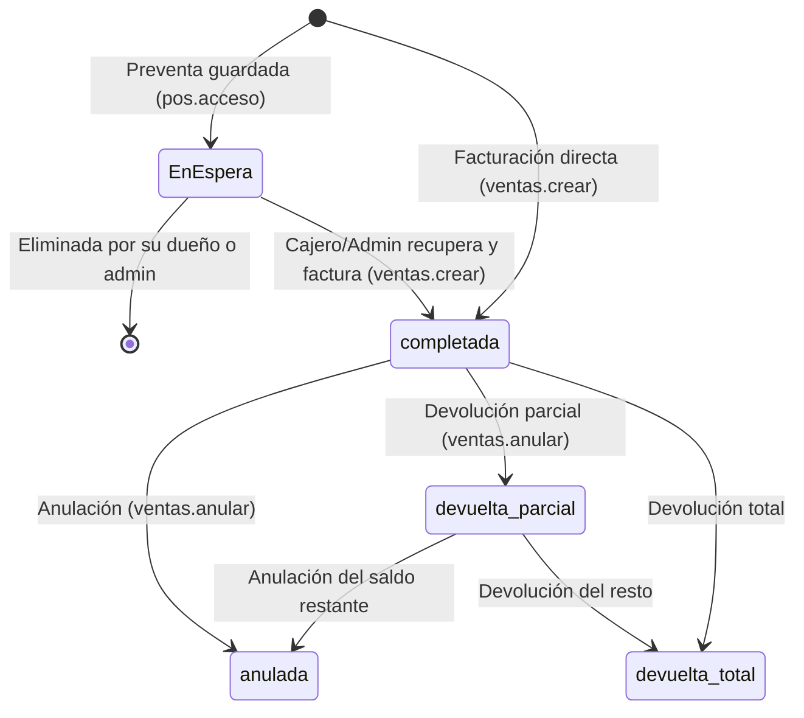

# Flujo de la factura (ciclo de vida completo)

## 1. Estados

`anulada` es terminal. Una factura `devuelta_total` no se puede anular ni devolver más.

## 2. Preventa (vendedor)

- Quién: cualquier usuario con `pos.acceso` + `pos.preventa`. Un Vendedor **solo** puede crear preventas.
- La preventa guarda: cliente, ítems, precios mostrados, tipo de venta, vendedor, nota. **No** mueve stock, no crea turno ni dinero.
- Dueño = `user_id` que la crea. El vendedor ve/edita/elimina **solo las suyas**; Cajero/Admin ven todas las de la empresa.
- El `vendedor_id` de la preventa queda **fijo** al recuperarla (el cajero no lo cambia; solo Admin puede reasignarlo con motivo).
- Una preventa se consume (se elimina) dentro de la misma transacción que la factura.

## 3. Facturación (cajero / admin)

**Precondiciones**
1. Permisos `pos.acceso` + `ventas.crear`.
2. Existe un turno abierto desde el cual facturar:
   - Cajero: su propio turno abierto. Sin turno → rechazar.
   - Admin/SuperAdmin: debe **elegir una caja con turno abierto** (selector obligatorio en la barra superior). Si hay una sola, se preselecciona; si ninguna, rechazar con "No hay cajas abiertas". `caja_id`/`caja_turno_id` nunca `null`.
3. Cliente activo (global). Venta a crédito **no** permitida a "Consumidor Final" (`V-00000000`).

**Validaciones del servidor (todas obligatorias)**
- `empresaId` y `userId` del contexto autenticado, sin fallback.
- Cada ítem: pertenece a la empresa; precio de lista = el del producto/servicio/moto según `tipo_venta`.
  - Precio distinto al de lista o descuento > 0 requiere `ventas.descuentos`; el descuento tiene tope configurable (por defecto 100% solo Admin; Cajero máximo definido en config).
- Almacén del ítem pertenece a la empresa y está activo.
- **Stock suficiente** por almacén para productos físicos → si no alcanza, error (nunca recortar a 0).
- Moto: `disponible` bajo `lockForUpdate`; Serial: pertenece al producto, al almacén y está `disponible`.
- Método de pago existe y está activo (global). Moneda ∈ {USD, VES}.
- Total y pagos recalculados en servidor.

**Efectos (una transacción)**
1. Correlativo `VEN-` y `numero_control` generados **bajo lock** (secuencia por empresa) con índice único `(empresa_id, codigo)` y `(empresa_id, numero_control)`.
2. Cabecera + renglones + pagos.
3. Kardex `salida_venta` por producto físico; moto → `vendida`; serial → `vendido`.
4. Pago insuficiente → `condicion_pago = credito` (parcial) y se crea CXC; pago ≥ total → `contado`, vuelto = exceso.
5. **Vuelto**: se registra como salida de efectivo del turno (ver `cajas-turnos.md`).
6. **Comisión (D2)**: `comision_porcentaje` y montos se congelan al emitir sobre `subtotal_neto`.
7. IGTF: no aplica (D5).

## 4. Anulación (D3)

Quién: `pos.acceso` + `ventas.anular`. Cualquier factura `completada` o `devuelta_parcial`, **sin límite de tiempo**.

Requisitos: motivo obligatorio (≥ 5 caracteres) y un turno abierto desde el cual registrar el movimiento de dinero (mismo criterio D6 para Admin).

Efectos (una transacción, con lock sobre la venta):
1. `ventas.estado = 'anulada'`; guardar `anulada_por_id`, `anulada_at`, `motivo_anulacion`.
2. Kardex `anulacion_venta` por la **cantidad aún no devuelta** de cada producto físico, al almacén de origen.
3. Seriales → `disponible`; motos → `disponible`.
4. **CXC**: si existe, estado `anulada`, saldo 0.
5. **Dinero**: todo lo efectivamente cobrado (pagos de la venta + abonos CXC recibidos − devoluciones ya reembolsadas) se reembolsa. Se registra un movimiento `egreso` por método en el **turno abierto actual** (no se toca el turno original, que puede estar cerrado) con referencia a la factura.
6. **Comisión**: `comision_monto_* = 0`.
7. La factura sigue visible e imprimible con sello "ANULADA".

## 5. Devolución (parcial o total) (D3)

Quién: `ventas.anular`. Cualquier momento. Requiere turno abierto (D6).

- Se elige renglón y cantidad ≤ `facturado − devuelto`.
- **Monto devuelto = valor neto del renglón proporcional** (precio − descuento, con IVA, proporcional a la cantidad), **no** precio de lista × cantidad.
- Kardex `anulacion_venta` (motivo "Devolución"); seriales/motos a `disponible`.
- **Reembolso**: `tipo_reembolso ∈ {efectivo, otro_metodo(id), nota_credito/saldo_cxc, sin_reembolso}`.
  - Efectivo/otro método → movimiento `egreso` en el turno actual por ese método.
  - Si la factura tiene CXC con saldo → primero se descuenta del saldo; solo el excedente se reembolsa.
- **Comisión**: se recalcula proporcional al **monto** devuelto sobre el `subtotal_neto` (no por cantidad).
- Estado: `devuelta_parcial` o `devuelta_total` (al cubrir el 100% de cantidades).

## 6. Cuentas por cobrar (CXC)

- Se crea al facturar con saldo. Abonos: `cxc.abonar` + turno abierto (rechazar sin turno).
- Cada abono actualiza **CXC y la factura** (`monto_pagado`, `saldo_pendiente`) y entra al arqueo del turno por su método.
- Abono mayor al saldo → rechazar.
- La comisión **no** depende del cobro (D2).

## 7. Consecuencias en otros módulos (checklist por cada operación)

| Operación | Kardex | CXC | Caja/Turno | Comisión | Reportes |
|---|:--:|:--:|:--:|:--:|:--:|
| Preventa | – | – | – | – | – |
| Factura | salida | crea si hay saldo | + pagos − vuelto | congela | suma |
| Abono CXC | – | − saldo + factura | + efectivo/otro | – | flujo de caja |
| Devolución | entrada | − saldo | − reembolso | − proporcional | resta |
| Anulación | entrada | anula | − reembolso total | 0 | excluye |

## 8. Cuentas por pagar (CXP) y compras

- Se crea automáticamente al procesar una recepción (`recepciones`) con `condicion_pago = 'credito'`.
- Permiso: `cxp.ver` para consultar estados de cuenta y `cxp.abonar` para registrar pagos.
- **Abono específico (`abonarFacturaEspecifica`):** Aplica el pago a una factura de compra individual bajo `lockForUpdate()`, actualizando `monto_pagado_usd`, `saldo_pendiente_usd` y estado (`'parcial'` o `'pagada'`).
- **Abono general FIFO (`abonarGeneralDeuda`):** Distribuye un monto global entre las deudas pendientes con el proveedor, amortizando o saldando primero las facturas más antiguas (`ORDER BY fecha_emision ASC FOR UPDATE`).
- **Trazabilidad de caja:** Los abonos se asientan en `cuentas_por_pagar_abonos`. Si el pago se realiza con efectivo físico del cajón, se debe registrar un egreso en el turno de caja para mantener el cuadre del arqueo.
